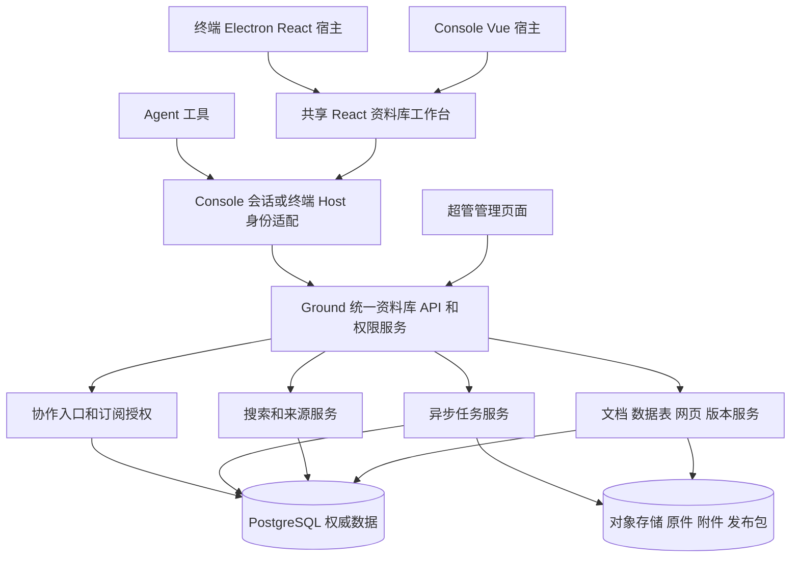

# 猛犸多端资料库复刻方案

状态：评审稿。本文描述拟建设能力，不表示功能已经实现、依赖已经采购或生产环境已经验证。日期：2026-11-09。

## 1. 目标与已确认要求

Console 和终端均完整支持文档、表格、网页的创建与编辑；超管沿用现有管理和代管规则；所有端访问同一套云端资料。Agent 作为当前用户的操作入口，也访问同一服务。各端界面可以不同，但资料身份、正文、版本、权限和操作结果必须一致。

复刻对象是 WorkBuddy 资料库的功能和交互。腾讯服务器内部算法不可见，不以内部实现相同作为验收条件。采用猛犸品牌、现有账号及权限，不把腾讯安装包中的私有模块当成可独立部署的后端。文档、原生数据表、网页及其互相引用属于同一个完整项目，不能只交付文件上传页面便称完成。

用户已确认产品范围。下文技术组合、默认行为和验证目标属于本方案的建议，供整体评审；这次不执行产品代码修改、数据迁移、采购和发布。

## 2. 结论和建设方式

推荐保留 NestJS、Prisma、PostgreSQL、现有身份体系、React 终端和 Vue Console。新增共享资料库工作台、统一内容服务、可编辑内容模型、检索、任务及协作服务。Console 用薄适配层挂载共享工作台，终端通过现有 Cordis 插件挂载相同工作台，避免复制两套编辑器。

“同一套数据”表示一个权威业务数据集，不要求所有内容挤进一张表。PostgreSQL 保存节点、工作内容、历史记录、权限及审计；对象存储保存原件、附件和不可变发布包；向量索引、预览、导出文件是可重建产物，不是另一份独立业务库。

### Approaches

| 方案 | 做法 | 取舍 |
| --- | --- | --- |
| A 两端各写编辑器 | Console 用 Vue 编辑组件，终端用 React 编辑组件，共享 API | 初期适配直接；编辑行为、键盘操作、块模型和功能升级会长期重复维护 |
| B 共享工作台，保留两端宿主 | 一份 React 工作台和领域协议，分别适配 Console 与终端；统一云端服务 | 推荐；需要做好打包、React 生命周期和宿主能力适配，但可保持两端同等能力 |
| C 接外部完整文档平台 | 采购整套编辑、表格和协作平台，围绕其内容模型接入 | 可能缩短编辑器研发；现有权限、资料身份、数据导出和私有部署需要专项验证，增加平台依赖 |

本稿按 B 展开。选择 B 不代表已有完整工作台；也不代表把现有原生 UI 插件直接运行在 Vue 页面中。

## 3. 现有基础及需要补齐的部分

| 领域 | 当前源码可见能力 | 本项目补齐内容 |
| --- | --- | --- |
| 身份与多端 | Ground 登录和租户；原生 Host 代理资料接口 | 新内容、协作、附件和检索全部接入同一身份策略 |
| 资料组织 | FILE、FOLDER、LINK；个人与企业共享；最近和回收站 | 原生 DOC、DATABASE、PAGE，个人及团队资料空间、稳定排序和导航 |
| 文件与版本 | 原件、版本、提取片段；引用固定具体版本 | 可编辑草稿、持久修改、不可变内容快照、恢复及跨类型引用 |
| Console 与终端 | Vue 管理页；React 原生资料面板、＋与 @ 引用 | 两端相同的创建、编辑、预览、版本、评论和发布能力 |
| 问答与检索 | 新库名称搜索和选版本摘录；旧 KB 独立检索 | 正文全文与语义检索、统一入口、问题相关段落召回和来源定位 |
| 工程保护 | 文件事务、配额事务锁、代管、审计 | 编辑冲突、持久确认、任务幂等、实时撤权和跨端兼容 |

旧 KB 的 64 维字符哈希向量不能直接当作语义模型索引继续使用。现有资料库和 KB 的接口、表及引用需要有计划地统一，不能仅改菜单名称。

## 4. 功能复刻和两端一致性清单

“完整”以以下功能清单及阶段 0 对 WorkBuddy 的逐项复核记录为准。首次观察不到的功能进入待验证项；不得写成已复刻。除了由现有权限决定的限制，Console 和终端每项功能都需要各自验收。

| 编号 | 最终交付能力 | 验收要点 | 阶段 |
| --- | --- | --- | --- |
| F01 | 个人资料、团队空间、目录树、排序、最近、共享、类型筛选 | 空间不等于租户；切换客户端仍定位相同 nodeId | P1、P2 |
| F02 | 文档创建及块编辑 | 标题、段落、列表、图片、代码、引用、文内表格、公式和图示；快捷插入与块操作 | P3 |
| F03 | 原生结构化数据表 | 字段、记录、批量粘贴、排序、过滤、分组、分页、视图、关联与汇总 | P4 |
| F04 | 数据表公式与视图 | 计算字段、循环引用报错；网格、看板、日历、画廊和表单视图 | P4 |
| F05 | 网页创建、源码与可视化编辑 | HTML/CSS/JS 项目、模板组件、实时预览、保存版本 | P5 |
| F06 | 网页关联资料库数据 | 读取绑定数据表、表单按权限提交；两端改表后网页读相同数据 | P5 |
| F07 | 上传、附件、文件夹导入、链接剪藏 | 明确目标；MD、CSV、HTML 转相应原生对象；其它文件保留原件和解析状态 | P2、P3、P4、P5 |
| F08 | 文件及内容导出 | 原件下载、MD/HTML/CSV；文档 DOCX/PDF 与表格 XLSX 的转换与损失提示 | P3、P4、P5、P9 |
| F09 | 版本、恢复、引用 | 恢复创建新版本；旧引用继续返回旧内容或明确来源不可用 | P1、P3、P4、P5 |
| F10 | 评论、讨论、Agent 修订建议 | 锚定具体块或单元格；接受/拒绝与审计；权限映射见第 6 节 | P3、P4、P7 |
| F11 | 多人协作和自动保存 | 双端在线成员、远端变化、重连、保存状态；不丢已确认持久化修改 | P3、P8 |
| F12 | 搜索与问答 | 名称、正文、语义检索；按当前权限过滤；答案回到真实版本和定位 | P6 |
| F13 | Agent 资料库工具 | 搜索、读取、创建、修改、表格操作、上传、导出、网页构建及发布 | P7 |
| F14 | 分享与协作入口 | 同一资料的链接和当前访问规则；不自动扩大权限 | P2、P5、P8 |
| F15 | 本地产物与会话联动 | 暂存附件、任务产物和已入库资料分清；显式保存后跨端可见 | P7 |
| F16 | 空间容量、配额、通知和回收 | 容量口径、任务失败、提及与修订通知、回收恢复行为一致 | P1、P2、P8 |
| F17 | 超管治理和代管 | 原管理规则、授权、冲突检查、操作原因及审计继续生效 | 全阶段 |
| F18 | 迁移和发布 | 旧资料、文件校验值、版本、可见性和旧链接连续；灰度、回滚及备份演练 | P0、P9 |

原生数据表是 WorkBuddy 的 database/CSV 类对象，不能用一个只能显示数组的 HTML 表格代替。Excel 工作簿属于兼容输入输出；宏、完整 Excel 函数、复杂打印排版不自动归入“100% Office 兼容”承诺。阶段 0 必须用实际样例列出公式和导入导出兼容范围，转换损失不能静默发生。

网页的源码模式保留原始项目。可视化模式操作受支持的模板/组件树；任意导入 HTML 不承诺无损往返转换成可视化组件。两种模式各自有真实保存和编辑能力，不强制重新生成并覆盖用户源码。

## 5. 推荐架构

统一服务先作为 Ground 内独立模块实现，协作进程及 worker 可单独运行；不是为每个端部署独立资料库。任务及全文/向量检索也按租户和资料身份处理，不能建立脱离权限的旁路。

### 5.1 技术选择与验证条件

| 部分 | 推荐 | 条件 |
| --- | --- | --- |
| 业务后端 | 现有 NestJS、Prisma、PostgreSQL | 不迁账号、计费和权限到第三方平台 |
| 共享前端 | React 18 兼容工作台，TypeScript，明确宿主接口 | Console 用 mount/unmount 适配；终端用 Cordis 注入；不合并两个既有 workspace 和锁文件 |
| 文档 | Tiptap/ProseMirror 开源编辑核心 | 文档格式和块 ID 归猛犸；评论、修订和版本不是默认免费成品功能，需要实现 |
| 文档协同 | Yjs；Hocuspocus 作为候选传输适配 | P0 验证撤权、持久确认和服务端命令接入；默认延迟存储钩子不能当作已保存回执 |
| 原生数据表 | PostgreSQL 行/字段模型，TanStack Table 和 Virtual 展示 | 编辑、公式、视图、历史及权限是本项目实现，不是装表格组件即可获得 |
| 网页编辑 | Monaco 源码编辑；自有组件树可视化面板 | 独立预览运行环境，源码和组件转换有明确范围 |
| 文件存储 | 可替换 BlobStore，生产采用私有对象存储 | 保留现有磁盘适配器供本地/迁移；上传凭据、下载链接按权限短时签发 |
| 后台任务 | PostgreSQL outbox 加 pg-boss worker | 任务可能重试；每项业务副作用仍需幂等，不能假定外部操作恰好执行一次 |
| 检索 | PostgreSQL 全文检索与 pgvector，接已有模型网关 | 中文需专门分词/归一化验证；不用默认英文全文配置冒充中文检索；embedding 模型和版本可配置 |

Univer 可作为“确实需要完整工作簿体验”的专项备选，不作当前默认依赖。其协作、导入导出和若干高级能力属于独立商业扩展；不能以开源核心存在推定完整能力已免费覆盖。未授权的商业组件、外部云编辑服务不进入默认数据路径。

P0 输出锁定版本、依赖许可证清单、浏览器/系统支持表和编辑器兼容样例。候选协作组件若不能满足持久确认及权限要求，应更换传输适配器，不改变猛犸数据格式和权限。

### 5.2 共享工作台交付

建议源代码位于根目录新增的 `shared/library-workbench/`，作为独立、可构建的浏览器库；按固定版本产出私有 tarball，分别由 Ground 和 mammoth-agent 的锁文件引用。不得让一个 workspace 直接导入另一个的源码或依赖目录。

工作台对外提供 mount/unmount、React 入口及纯数据协议；不依赖 Cordis、Vue、Electron、账号服务或任一宿主业务插件。Console/终端适配器负责身份连接、路由、主题、语言、对话草稿和本地文件选择。源数据由统一客户端对象和资源层管理；不得把一份业务状态重复镜像进两套界面 store。

首版随宿主固定版本发布，不以远程 Module Federation 作为开工前提。远程独立发布可后续单独设计客户端兼容、回滚、加载失败和资源完整性机制。

## 6. 权限沿用规则

以现有 `canSee`、`canManage`、登录态租户和代管服务为权限来源。新增动作映射如下，不增设默认超管越权、匿名编辑或成员自动写权限。

| 动作 | 原规则映射 |
| --- | --- |
| 列表、读取、检索、预览、来源、只读订阅 | canSee，并检查资料状态和当前租户 |
| 创建 | 有效成员；所有者由服务端确定；创建位置、scope 和代管要求沿用现有规则 |
| 修改正文、字段、单元格、网页源文件 | canManage；写请求还校验 baseRevision 或协作写权限 |
| 评论、提修订、接受/拒绝、恢复版本 | 首版映射 canManage；没有既有评论权限时不默认向只读成员开放写入 |
| 分享、改可见性、发布、数据绑定写入 | canManage 及现有共享确认、目标授权检查 |
| 超管正文及管理操作 | 平台身份加对应有效代管；沿用授权范围、到期、撤销、原因和审计 |
| Agent 动作 | 当前实际用户、租户、代管范围与目标资源授权；工具声明不构成授权 |

现有企业共享规则允许企业成员读取，不代表所有成员能编辑。因此多人共同写入仅限当前规则确实允许管理该资料的人。团队空间可以提供多个内容容器，但不擅自新增一套空间成员授权来绕开现有个人/企业及代管规则。

WorkBuddy 的匿名公开链接若与现行规则不匹配，采用登录后按原权限访问的分享/发布链接。匿名访问默认关闭；用户日后另行调整权限规则后才可启用。这个差异属于用户指定权限优先，不应偷偷用“获得链接的人”扩大可见性。

权限检查覆盖 REST、协作消息、搜索结果、媒体、下载、导出任务、网页绑定数据和后台 worker。已打开的连接和任务在撤权后不能凭旧缓存继续获取或写入新内容；提交时重新校验。已合法下载到对方设备的内容不能远程收回，撤权保证只针对后续访问与写入。

## 7. 数据模型与版本

### 7.1 身份和目录

保留现有 LibraryNode ID、所有者、租户、原 scope、回收状态和目录关系。新增内容种类 DOC、DATABASE、PAGE，不改写旧 FILE 的含义；增加空间归属与有序目录位置。LibrarySpace 只组织个人/团队容器，实际授权继续落到原角色及内容范围。

现有 FILE 的 LibraryVersion 原样保留。新内容增加 LibraryHead（工作状态）、LibraryRevision（不可变快照）、LibraryOperation（持久修改记录）、LibraryComment、LibraryProposal、LibraryAsset、LibraryOutbox、LibraryJob、LibraryPublication。数据表另有稳定 fieldId/rowId/viewId、结构和记录历史。所有实体均绑定 tenantId 与 nodeId，并建立可核对的复合关系及索引。

### 7.2 草稿和可引用版本

headCommitRev 是每个对象已持久修改的递增序号，工作状态随编辑变化；revisionId 是可引用、不可变的快照身份。接入 Agent、导出和发布时冻结指定 headCommitRev，形成或复用 revisionId，不把“当前最新版”当成稳定来源。

文档的工作状态由服务端持有的 Yjs 文档及已持久更新链重建，ProseMirror JSON 是校验后的导出/快照，不能成为另一个独立可写版本。数据表工作状态是 SQL 结构与行记录，每项修改与修订历史同事务记录；历史快照或保留的事件足以还原被引用版本。网页工作状态是受版本管理的源文件集合及可选组件树，发布包从确定修订生成。

文件 versionId 继续被旧引用使用；新 citation 包含 nodeId、revisionId 和稳定定位。定位使用 blockId、rowId/fieldId、page asset/section，而不是容易变化的屏幕行号。表格问答还冻结实际读到的行集合、查询条件和数据修订，不用一个动态查询链接冒充当时证据。

自动保存确认与历史快照不同：每次持久确认都可恢复，但历史面板可以按命名、会话间隔和重要操作生成快照。合并日志时必须保留所有尚被引用/发布的修订所需状态；不能为了节省空间改写旧来源。

恢复历史内容创建新的当前修订，并保留恢复前状态；不把旧修订改成新内容。文档恢复同时递增 documentEpoch 并使旧房间失效，恢复前的离线更新不能自动合并回新状态；客户端显示待处理差异。回收、撤权或彻底删除后的读取延续现有拒绝行为。

### 7.3 一致提交

所有元数据、正文及结构化表修改都经过内容命令服务。修改携带 requestId 和相应前置条件：文档/网页直接修改及数据表结构修改检查 headCommitRev；数据表行修改检查 schemaRev 及受影响行的 rowRevision，因此不同记录可以独立成功；可合并的文档协作更新检查 documentEpoch 和 updateId，不用全局旧版本检查阻止正常 CRDT 合并。重复请求复用结果，相应基线冲突明确返回。操作、修订、审计和 outbox 在同一数据库事务提交，提交后才发布事件或确认“已保存”。跨资源操作按固定顺序取锁。

文档编辑客户端可以先显示本地变化，但仅服务器给出 durableRevision 回执后显示“已保存”；该值是已提交 headCommitRev 的数值，不是不可变快照的 revisionId。协作同步成功不能代替数据库持久成功。Hocuspocus 默认 debounced store 不能满足这个语义；适配层必须补持久确认和按节点的写入串行化，并在 P0 用进程中断实验验证。

大文件上传先申请受限凭据，校验文件长度、摘要及目标权限后确认挂接；异步解析和索引由幂等任务处理。对象存储和数据库无法组成同一事务，使用上传会话、状态机、outbox、补偿及孤儿核对任务管理中断；删除采用墓碑和可重试清理，不先把唯一原件删掉再尝试记录结果。

## 8. 三类内容如何实现

### 8.1 文档

支持块编辑、快捷插入、拖动、文内表格、图片与附件、代码、数学公式、图示及资料引用。自有 schemaVersion 和稳定 blockId 支持评论、修改提案与来源。粘贴、复制块、导入时分配新块身份；旧客户端遇到未知块不得静默删除。

Agent 修改已有文档默认生成按块定位的建议，展示前后差异、基线修订和影响范围。接受时检查内容及权限；基线变化返回冲突或重新生成建议，不直接覆盖。用户明确要求直接编辑且现有权限允许时，可走相同命令服务直接修改。建议机制使用普通可审计领域对象实现，不假设商业追踪修订扩展免费可用。

MD/DOCX 导入保留原件并新建原生内容，转换报告列出不支持的块。导出 MD/HTML 为确定格式映射；DOCX/PDF 在隔离 worker 转换，并用固定样例验证段落、表格、图片和中文字体。复杂版式不承诺字节或版面完全相同。

### 8.2 原生数据表

字段包括文本、数字、日期、布尔、单选、多选、链接、附件、关联及计算字段。每个字段和记录有稳定身份；排序不改变引用身份。字段定义与行值由服务端验证，大批导入及计算走任务。查询、分页、排序、过滤和权限下推服务端，不能先把全企业数据加载到浏览器。

计算字段采用无网络、无文件能力的表达式解析器和允许函数集合；首版验收集合包含算术、比较、IF、SUM、AVERAGE、COUNT、CONCAT、日期提取，关联汇总按稳定字段 ID 计算。循环依赖、除零、空值和类型错误显式呈现。公式不使用 JavaScript eval，也不允许读取未授权关联资料。

同时编辑不同记录可独立提交；同一记录/结构的陈旧修改返回冲突和当前状态，不使用静默最后写入覆盖。多人变化用提交后事件同步。字段删除及类型转换提供影响预览并按现有确认规则执行，相关网页绑定、公式和引用在影响清单中体现。

提供网格、看板、日历、画廊和表单视图。视图保存布局及查询，不复制业务行。CSV 导入处理编码、中文字段、引号、换行和类型预览；XLSX 输入输出专项实现或接经确认的转换组件，不能依赖未采购的商业插件。

### 8.3 网页及数据绑定

网页保留 HTML/CSS/JS、资源清单和可选模板组件树。Console 与终端均可源码编辑、模板可视化编辑、预览、保存版本和发布。任意 HTML 导入后源码可编辑，可视化兼容性明确显示，不强制自动重写。

预览和发布运行在独立、无账号 cookie 的来源及受限 iframe 内。页面代码得不到 Ground JWT、宿主桥接或任意资料请求能力。CSP、资源代理和受限通信通道阻止把页面脚本当宿主脚本执行；外部资源按配置清单处理，不默认开放所有网络。

页面通过只允许绑定资源的 Data SDK 请求数据。后台使用实际访问者身份验证绑定表、动作和字段；前端只传页面通道和资源别名，不把长期凭据交给网页。表单提交同样走命令服务及配额。预览默认不执行写入，需明确操作才能提交。

发布固定代码修订与资源清单，草稿修改不改变已发布页面；重新发布创建新发布记录。数据绑定可以选择随当前数据读取或绑定快照，界面标明两者区别；回答、审计和导出必须固定实际读到的数据版本。发布和访问均沿用现有角色范围。

## 9. 检索和 Agent

统一名称、正文、分词全文及语义检索；embedding 模型通过现有模型网关配置，存储模型身份、维度和索引版本。模型改变新建索引并回填验证，不混用不同向量空间。关键词/向量召回后合并排序，返回摘要、revisionId 和 locator，再按需读取更多正文。

中文检索使用经过中文测试集验证的分词/归一化及匹配策略；部署未具备所需分词扩展时可先保留应用分词和数据库索引，不能把 PostgreSQL 默认 simple 配置当中文质量已解决。检索须在授权集合内召回或查询，召回后仍复核授权；不能泄漏私人标题、数量、摘要或过期片段。

旧 `/console/api/kb/retrieve` 过渡为统一检索的兼容入口，逐租户迁移旧资料及授权后切换，不再维护两套业务写入口。原生选择引用和企业检索进入同一来源服务；显式选资料不是检索全企业的授权。

Agent 工具建议为 `library_search`、`library_read`、`library_create`、`library_propose_edit`、`library_apply_edit`、`library_table_query`、`library_table_mutate`、`library_upload`、`library_export`、`library_publish`。工具调用到结果写入现有会话日志；不为这项功能改 Agent 主循环。Console 通过现有模型网关和可复用工具执行适配获得同等能力，终端通过 Cordis 插件注册消费者，二者共用后端内容操作。

Console 的工作台提供资料操作面板，后台持久保存该次模型请求、工具调用、结果和修订回执为 LibraryToolRun；不用假设现有纯文本问答接口已经能运行工具。终端将相同工具事件写入现有 Session，Console 使用 Ground 的操作记录，并以同一 toolRunId/operationId 关联；这些是操作记录，不是复制正文。Console 本地文件来自显式浏览器选择，终端本地文件来自明确选择的任务产物或工作区路径，二者不会因功能同等而获得相同的本机磁盘能力。

模型产生的 nodeId、路径、表名或权限陈述均不被信任；服务端解析实际目标与身份。工具结果包含目标 ID、修订、定位、任务状态及真实链接；文件尚未产生时不返回假下载地址。资料文本是来源，不能作为系统指令执行。本地产物只有显式保存后才入库，不默认上传整个工作区。

## 10. 协作 生命周期与多端兼容

文档使用 Yjs 合并可合并修改；数据表使用记录/结构修订检查，网页源文件使用文件级修订和差异处理。它们共享身份、持久回执和事件序号，但不强迫所有内容使用同一种冲突算法。

订阅按 tenantId/nodeId 建立，持续检查当前角色、租户和代管授权。权限修改事务写出策略变更事件；发送正文和接收写入均检查策略有效性，撤权后断开或降权。离线积累的操作恢复连接后重新鉴权；无权或基线冲突时停止上传，保留可见的本地待处理提示，不偷偷新建共享副本。

Console 和终端使用兼容的 schemaVersion 和能力协商。旧终端不能解码的新对象明确提示升级，禁止把未知块以空文档保存。静态包分别锁定版本；首版不依赖同步升级所有已安装客户端。

浏览器及桌面的草稿缓存按账号和租户隔离，切换身份立即停止旧任务、清除可用内存和旧通道。持久本地缓存仅保存明确需要恢复的草稿，不能在新账号界面重放；完整离线浏览全部资料不作为默认功能。

## 11. 迁移 兼容和回滚

1. 盘点 LibraryNode/Version/Chunk、旧 KB 文档和 grants、原件目录、旧引用及实际客户端版本；先做数据库和原件一致备份与恢复演练。
2. 先发布兼容服务：旧 API 仅返回它可理解的种类，新内容走 `/api/library/v2/*`。确认旧终端和旧服务器不会因新枚举/字段失败后，再允许创建新种类；保留可回退的最低服务版本。
3. 新 schema 采用增加式迁移。旧 FILE 和原 versionId 不重写；MD/CSV/HTML 可显式生成新的原生对象，并记录 originFileVersionId，原件继续可下载。
4. 旧 KB 每项建立 LegacyMapping，复制或接管原件并校验摘要、数量和授权。旧的定向 grants 不能粗暴转成全企业共享；需要兼容授权读取适配，直到有等价规则。迁移幂等，切换前冻结该租户旧写入口，核对后一次切读写。
5. 新索引从已确认修订构建，未就绪时真实显示 pending 或退回权限内关键词检索，不能返回空成功冒充全部索引完成。
6. 先测试环境，再单企业灰度，再扩大；每阶段 Console 与终端都验同一组资料。新旧接口并行期只有一个权威写服务。
7. 回滚先关闭新建/写入功能并退回兼容服务，不删除新数据或强行还原数据库枚举。已产生的新内容保留为只读及可导出；未确认数据一致时停止迁移，不自动覆盖源库。

任何生产迁移、切换或发布都作为后续独立操作交付。本稿不代表已安排或执行。

## 12. 非功能目标和验收环境

以下是拟验收目标，不是现有性能测量。P0 固定机器、数据库、网络和样例，记录最终容量与配置；未经测量不承诺工期或可服务客户数。

| 场景 | 拟验收目标 |
| --- | --- |
| 企业目录 100000 节点 | 服务端分页每次 50 条，权限过滤正确；API p95 不高于 800ms |
| 数据表 100000 行 100 字段 | 服务端分页与可视区渲染，不能全量下载；首屏 API p95 不高于 1s |
| 同一文档 20 名合法编辑者 | 不丢已持久确认修改；标准测试网络下保存回执 p95 不高于 1s |
| 跨端更新 | 正常在线订阅下 2s 内可见；断线重连补齐，不靠手动刷新纠错 |
| 100000 个索引片段 | 包含查询向量请求的检索 p95 目标 3s，外部模型超时有明确结果 |
| 身份切换和撤权 | 后续服务器读取及写入拒绝；旧连接不得继续取得新正文；客户端 2s 内退出可编辑状态 |
| 版本与故障恢复 | 已显示“已保存”的内容，在协作服务重启和 worker 重试后可恢复；历史引用逐项保持 |
| 文件上限及配额 | 沿用现有配置，默认不扩大；分片和异步处理不能绕过企业容量、配额及格式检查 |

相同身份和权限下，两端功能验收矩阵必须全部通过。还要覆盖中文输入法、复制粘贴、键盘、图片及中文字体、长文、弱网、重复提交、低版本客户端、同单元格冲突、后台任务取消、修改中回收及撤销代管。

## 13. 分阶段里程碑

| 阶段 | 交付 | 依赖 | 完成标准 |
| --- | --- | --- | --- |
| P0 基线与验证 | 功能对照、权限矩阵、依赖锁定、编辑/协作/转换实验、迁移清单 | 本稿评审 | 未验证能力明确；两个宿主均可加载编辑原型；持久/撤权要求验证；形成工程量预算 |
| P1 统一领域底座 | v2 协议、权限动作、原生种类、修订、命令、outbox、兼容层 | P0 | 两端同节点 CRUD；越权/旧基线/重复请求测试通过；原引用不变 |
| P2 双端工作台和文件流水线 | 共享壳、目录、空间、最近、分享、上传/附件、异步解析 | P1 | Console/终端同一资料与状态；失败/重试/配额有真实回执 |
| P3 文档 | 两端编辑、稳定块、自动保存、版本、评论/修订、基础导入导出 | P2 | 两端交叉编辑和引用历史；不支持块无静默丢失 |
| P4 数据表 | 字段/记录/公式/关联/多视图/表单、CSV/XLSX 转换 | P1、P2；可与 P3 后半段并行 | 两端完整编辑；冲突、公式错误、关联权限与大表分页验收 |
| P5 网页 | 双模式编辑、资源、受限预览、数据绑定、认证发布和回滚 | P3、P4 | 两端修改同页；发布不被草稿覆盖；网页无法取得宿主凭据或越权数据 |
| P6 统一搜索 | 正文/语义/中文检索、旧 KB 兼容、来源冻结 | P3、P4，网页提取接 P5 | 真实问题能找到后部段落；撤权和旧引用正确；索引重建可恢复 |
| P7 Agent 全链路 | 双端工具、修订、任务产物保存、真实导出及发布回执 | P3 至 P6 | 真实模型分别完成文档/表格/网页操作，身份权限及会话来源可核对 |
| P8 协作和完整体验 | 多人、重连、撤权、通知、离线待处理、跨类型评论 | P3、P4、P5；基础协作设计始于 P0 | 两端并发与进程中断实验通过；未确认修改不伪装已保存 |
| P9 迁移与上线验收 | 旧数据迁移、全矩阵、负载、备份恢复、灰度及回滚演练 | P0 至 P8 | 不以演示代替真实数据演练；全部需求有证据后才称完整复刻 |

P3/P4/P5 都不是“以后再给 Console 补”的终端专用阶段。可以在工程内部并行，但每阶段交付必须包含两端。P3 的基础自动保存不能等 P8 才考虑数据丢失；P8 是完整多人及故障验收。

## 14. 范围与投入控制

这是跨内容模型、编辑器、表格、网页运行环境、权限和迁移的项目，不是替换一个页面。技术上可以实现；当前证据不足以给出可信的日历交期和完整商业组件预算。P0 用代表性样例确定性能、格式兼容和剩余研发量，再按 P1 至 P9 分项估算、排人员和交付窗口。

控制投入的方式是保留已有业务基础、共享工作台、先打通每类内容的端到端路径，再完成高级交互。阶段成果可评审可试用，但文档、数据表、网页、Agent、权限和完整迁移未全部验收前，不把它宣传为完整复刻。商业组件若能明显缩短工期，可单独形成价格/数据/部署/退出方案评估，不默认采购。

## 15. 来源与核对位置

### 当前项目源码

以下路径相对统一项目根目录 `/Users/luoxiaojun/Documents/mmp/mmp`；行号是本次读取的定位，不是未来修改后的固定位置。

- 中台和终端独立 workspace：[根 README](../../../README.md)。
- 现有种类与数据模型：[schema.prisma](../../../ground/apps/backend/prisma/schema.prisma)，855、892、921、946 行。
- 原权限：[library.policy.ts](../../../ground/apps/backend/src/library/library.policy.ts)，30、59 行；[登录态 actor](../../../ground/apps/backend/src/library/library.controller.ts)，327 行。
- 超管授权及冲突：[library.admin.service.ts](../../../ground/apps/backend/src/library/library.admin.service.ts)，64、75、105 行。
- 事务及配额锁：[library.prisma-store.ts](../../../ground/apps/backend/src/library/library.prisma-store.ts)，94、122 行。
- 引用和现有问答：[library.service.ts](../../../ground/apps/backend/src/library/library.service.ts)，462、505 行；[摘录拼接](../../../ground/apps/backend/src/library/library.ask.ts)，39 行。
- 原生资料 UI、引用与适配：[原生插件](../../../mammoth-agent/packages/client/ui-enterprise-library/src/client/index.ts)，40、188 行；[Host 代理](../../../mammoth-agent/packages/credentials/deepseek-account-platform/src/ground-library.ts)，9、67 行。
- 旧知识库入口：[ground-billing.ts](../../../mammoth-agent/packages/credentials/deepseek-account-platform/src/ground-billing.ts)，25 行；[旧 hash embedding](../../../ground/apps/backend/src/knowledge/index-text.ts)，82 行。

### WorkBuddy 调研及技术组件

- [WorkBuddy 资料库溯源报告](../../../../workbuddy-library-investigation-20261109/WorkBuddy资料库实现解读.html)：本机 5.9.3 加当前公开资料库脚本；服务器实现、自动图覆盖及实际加载版本匹配的限制见该报告。
- [Tiptap 官方编辑器说明](https://tiptap.dev/docs/editor/getting-started/overview)：开源核心与 Pro 扩展不同；框架适配不等于成品业务。
- [Tiptap UI 组件范围](https://tiptap.dev/docs/ui-components/getting-started/overview)：评论和版本等组件可能依赖付费扩展/服务。
- [Hocuspocus hooks](https://tiptap.dev/docs/hocuspocus/server/hooks)：onStoreDocument 默认延迟执行，不能据此推定同步消息已持久保存。
- [Univer 官方项目](https://github.com/dream-num/univer)：开源核心和商业扩展的能力范围不同。
- [TanStack Table](https://tanstack.com/table/latest/docs/introduction)：表格状态和展示工具，不是完整资料库数据服务。
- [pgvector 官方项目](https://github.com/pgvector/pgvector)：PostgreSQL 向量检索及混合检索能力。
- [pg-boss 作业与 worker](https://github.com/timgit/pg-boss/tree/master/docs/api)：任务事务、重试及业务副作用的实现条件。

实施顺序、拟新增文件、接口和测试见[分阶段实施计划](../plans/2026-11-09-workbuddy-library-plan.md)。
