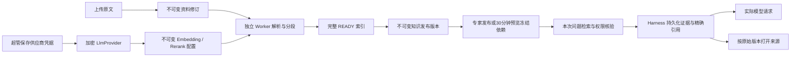

# 官方专家知识检索：配置、操作与验收

> **2026-11-11 当前验收入口与真实向量状态（优先于下方历史记录）：** 使用 `http://127.0.0.1:62560/admin/official-agents`，独立工作树 Web 62564 / API 62563 / Host 55442；不操作其他检出的 5201。知识库已接本机 FastEmbed `BAAI/bge-small-zh-v1.5`（512维），服务62565；工程模拟供应商已退役，返回410。配置入口为“猛犸知识库 → 高级设置 → 检索服务配置”。本机安装、启动和无密钥接入见 [local-embedding README](../tools/local-embedding/README.md)。当前新索引身份为 `knowledge-parser-v4` / `token-chunker-v2` / `chapter-context-v1`，仅向量输入携带有界章节上下文，引用正文保持原文。检索仍保留6条及既有预算；相邻扩展最多读取前后各2条，先去重并优先同章节连续切片，避免重复项挤掉中间步骤。用户明确给出的全大写框架/标识词会对现有候选中的同名完整章节词作稳定前移（在可选重排之前），AIDA不匹配AIDMA；诊断以EXACT_HEADING_FOCUS标记，RRF分数不改写。原上传文档和历史发布版本保留，未发布线上。真实回答与来源验收以本轮验收报告为准。


本文对应隔离工作树 `/Users/luoxiaojun/.codex/worktrees/official-experts-rag/mmp` 中的实现。代码尚未发布，未替换已安装 Mac 应用。**2026-11-10 已修复原会话摘要校验错误，并完成 V4→V5 会话存储迁移及正式兼容确认。** 当前可在独立 Chrome 窗口验收本地流程；真实模型质量、费用及正式发布仍须另行验收。

## 1. 先分清窗口和环境

| 窗口 | 用途 | 本轮边界 |
|---|---|---|
| 浏览器 | 超管配置、上传、发布、预览和查看引用 | 地址只使用 `http://127.0.0.1:5201`。本轮由私有浏览器代理转到隔离工作树，不向原 5201 服务写入。 |
| 终端 | 构建、独立 Worker、自动化测试 | 仅使用专用数据库 `127.0.0.1:55441/mmp_rag_acceptance`；私有 UI 使用另一库 `mmp_rag_ui_acceptance`。不得复用原业务库。 |
| Codex | 核对源文件、测试日志、评测记录和未完成门禁 | 确认当前工作树与运行进程归属。不要重启其他工作使用的 3100/5201，不复制其他项目 `.env`。 |

**本轮验收曾使用私有 API 62563、模拟供应商 62561、标准 Harness Web Host 55442。** 这些是本地验收实例，不是产品端口约定。实例信息记录在 `.superpowers/sdd/2026-11-09-official-experts-rag/browser-fixture-state.json`；是否仍运行，先核对该记录与端口，由 Codex 协调，不要据旧 PID 重启进程。私有 UI 的 `openQa()` 负责登录与转发。普通浏览器直接访问原 5201 不等于打开这套隔离代码；由 Codex 启动私有验收浏览器。

本次已打开独立 Chrome 验收窗口，并登录“本地验收超管”。2026-11-10 界面纠偏后另开标题为“本地验收 · 新版专家编辑（三栏）”的窗口；原验收窗口保留，不主动刷新其中未保存的输入。请在新版窗口按以下顺序验收：

1. **浏览器 → 专家配置：** 找到“页面验收示例专家”，点“编辑”进入全屏三栏：左侧个性化、中间能力、右侧预览。点击右侧“保存并试聊”，在同一页面打开真实标准会话。
2. **浏览器 → 会话：** 提问“`MMP-UI-55441 的接待时间是什么？请给出资料引用。`”，展开“知识来源”并点引用，确认打开“本地验收资料.md”的对应段落。
3. **浏览器 → 猛犸知识库：** 选择“页面验收示例知识库（模拟数据）”，检查原文、分段、READY 索引和知识发布；“检索服务配置”可管理独立供应商凭据。

当前演示连接本地模拟服务，只验收配置、处理、版本和引用流程，不代表真实模型的召回准确率。会话当前写入格式为 5；已有 V4 原件保留，写入前通过验证生成 V5 后继。不要手动改日志版本号。实际窗口状态与验收证据记录在 `.superpowers/sdd/2026-11-10-persistence-local-acceptance/`。



### 本地入口纠正（2026-11-10）

当前普通浏览器访问 `http://127.0.0.1:5201/admin/official-agents` 已连接本工作树新版。网关通过 `MAMMOTH_WEB_ORIGIN=http://127.0.0.1:62564`、`MAMMOTH_API_ORIGIN=http://127.0.0.1:62563` 和 `MAMMOTH_AGENT_WEB=http://127.0.0.1:55442` 选择完整验收服务。此前文档中的私有浏览器转发是旧验收方式，当前正常入口无需该转发。

当前使用独立 `mmp_rag_ui_acceptance` 样例数据和本地验收超管。原窗口刷新时可能需要重新登录。原工作目录的 API 3100、Web 5202 仍运行；当前网关不再指向它们。原46位专家属于原数据环境，当前验收列表包含2位样例专家。运行进程与恢复信息见 `.superpowers/sdd/2026-11-10-expert-editor-workspace/normal-entry-state.json`。默认未传上述环境变量时，网关仍按 5202 / 3100 / 3080 启动。

本地入口已重新接入新版服务，旧 `5205` 链接通过 307 跳转到 `5201`。最新进程和浏览器证据记录在 `.superpowers/sdd/2026-11-10-login-new-expert-integration/`；该目录的 `start-gateway.sh` 固定新版三项上游，须在上述服务仍运行、5201 已空闲时启动。当前是本工作树的本地运行接入，尚未把新版合并到主工作目录；主目录的 `pnpm run dev` 仍启动主目录代码，不是这套新版验收启动命令。

网关在 WebSocket 上游尚未完成握手时也处理客户端连接重置，并关闭待建立的上游请求，避免一次浏览器断连使整个登录入口退出。回归命令为 `node --test ground/scripts/dev-gateway.test.mjs`（在本工作树根目录运行）。

## 2. 浏览器：先配置供应商凭据

1. 使用拥有 `super_admin` 平台角色的账号进入 **平台管理 → 猛犸知识库 → 新知识核心（不可变发布）→ 检索服务配置**。只有普通平台后台访问权限不够；服务端每次重新检查账号状态和超管角色。
2. 点 **新建供应商凭据**，填写短名、显示名称、Base URL 和 API Key。检索专用供应商不要求聊天 Model ID，创建后聊天模型数为 **0**。密钥复用现有 `LlmProvider` 加密存储，列表只显示掩码，不会返回原始密钥或密文。
3. 点该行 **管理凭据** 可改名称、Base URL、密钥或启用状态。编辑框中的密钥默认留空；**留空保留原密钥**，填入新值代表轮换。只有勾选 **明确清除已保存密钥** 并确认才清除。关闭弹窗会清空输入框里的临时密钥。
4. 可选择已存在的聊天供应商共用凭据。轮换/清除/停用会影响所有引用它的聊天与检索配置。已有聊天模型时，保存密钥、修改 Base URL 或重新启用会沿用既有聊天连通探测，**可能计费**；零聊天模型供应商没有这些聊天探测。不要把“本地配置检查”误解成所有保存操作都没有外部请求。
5. 被不可变检索配置引用的供应商不能删除，删除接口返回可操作的 409 冲突；可停用以撤销使用。删除该供应商最后一个聊天模型时，仍保留被检索配置引用的供应商。不会级联删除历史配置。

依据：`apps/backend/src/knowledge-core/provider-admin.controller.ts:16`；`apps/backend/src/knowledge-core/admin.controller.ts:27`；`apps/backend/src/llm/llm-providers.service.ts:245`；`apps/frontend/src/components/admin/KnowledgeCoreAdmin.vue:259`。

## 3. 浏览器：建立 Embedding / Rerank 服务配置

1. 在同一页点 **新建服务配置**。选择供应商、任务和供应商实际模型名。Embedding 填实际向量维度；Rerank 不填维度。这里的模型名不会登记成聊天模型。
2. 核对完整接口 Endpoint。留空时从供应商 Base URL 派生 `/embeddings` 或 `/rerank`。线上接口要求 HTTPS；本地测试允许回环 HTTP。模型、维度、Tokenizer、端点、超时和批量等参数保存后冻结。
3. 新建配置的批量默认值为 32。融合候选最多 20 条；较小的不可变 Rerank 容量仍可使用：仅对全局融合排名前 `batchSize` 条做一次重排，其余保持融合顺序接在后面，并记录 `RERANK_GLOBAL_PREFIX_LIMIT`。不会分批比较未校准分数；批量必须为 1–128 的整数。默认 Tokenizer 是 `cl100k_base`，可选 `o200k_base`。这是明确的本地预算计算器，不代表供应商一定采用同样的 Token 计费。
4. 保存后看 **本地配置有效（未请求供应商）**。它只证明配置、启用和密钥可解密，不能证明供应商在线、语义质量或余额。
5. 如需验证连通，点 **主动探测（可能计费）** 并确认。探测发送固定短文本，显示时长、估算 Token、供应商返回的实际 Token（可能缺失）。探测和实际检索都会有 provider usage 记录，但这不是供应商发票。
6. 变更模型、维度、端点或其他冻结参数时点 **创建后继版本**，再建新索引/新知识发布版本。仅修改供应商 Base URL 不会重定向已冻结配置；密钥轮换则通过同一凭据引用生效。

依据：`apps/backend/src/knowledge-core/profiles.service.ts:78`；`apps/backend/src/knowledge-core/provider.ts:155`；`apps/backend/src/knowledge-core/admin.controller.ts:70`；`apps/frontend/src/components/admin/KnowledgeCoreAdmin.vue:212`。

## 4. 终端：确保独立 Worker 可用

HTTP API 不会自动启动索引 Worker。API 与 Worker 必须共享：

| 环境变量 | 含义 |
|---|---|
| `DATABASE_URL` | 同一套已迁移的专用 PostgreSQL / pgvector 数据库。 |
| `LLM_API_KEY_SECRET` | 同一加密主密钥；不一致会导致凭据无法解密。不要打印或写入报告。 |
| `KNOWLEDGE_CORE_DIR` | 同一私有原文目录，Worker 必须能读 API 保存的内容；不要挂成静态网站目录。 |
| `JWT_SECRET` | API 的登录签名配置；Worker 本身不依赖登录。若旧环境把它用作密钥加密回退，必须按既有密钥方案保持一致，不能随意换值。 |

**本轮私有 UI 验收实例曾启动 Worker；是否仍运行先由 Codex 核对进程与端口，不要重复启动或擅自重启。** 在另一个明确授权的新隔离环境，先由管理员把以上值安全注入终端，再运行：

```sh
cd /Users/luoxiaojun/.codex/worktrees/official-experts-rag/mmp/ground
: "${DATABASE_URL:?请先配置专用测试数据库}"
: "${LLM_API_KEY_SECRET:?请先安全配置与API一致的加密主密钥}"
: "${KNOWLEDGE_CORE_DIR:?请先配置与API一致的私有原文目录}"
pnpm --filter @mammoth/backend build
pnpm --filter @mammoth/backend knowledge:worker
```

这个终端持续运行。按 Ctrl-C 会请求 Worker 停止并关闭数据库连接。Worker 用租约、心跳和数据库事务防止取消后或失去租约后发布结果。暂时性上游故障最多自动尝试四次；永久错误不会无限重试。

前端构建必须设置 `VITE_AGENT_WEB_URL=http://127.0.0.1:5201/agent/` 指向本地标准 Host；未设置时预览会显示“未配置专家会话地址”并不生成死链接。标准终端会话由 Harness 的 `mmp web` profile 启动，不要启动包内 demo/bin 代替产品。本轮私有启动参数记录在 `start-harness-qa.sh`，使用独立 `MMP_HOME`、明确的 Ground/SSO origins、公开地址 `http://127.0.0.1:5201/agent/` 与支持的浏览器目录选择器 patch；由 Codex 协调该实例。

依据：`apps/backend/src/knowledge-core/worker-main.ts:7`；`apps/backend/src/knowledge-core/ingestion.worker.ts:18`；`apps/backend/src/knowledge-core/jobs.service.ts:15`；`apps/backend/src/knowledge-core/storage.ts:11`；`apps/backend/src/llm/llm-key-crypto.ts:5`。

## 5. 浏览器：上传、检查原文和发布知识版本

1. 打开 **知识库与索引 → 新建知识库**，选好 Embedding 配置。
2. **替换资料** 留空代表新增文档；选择已有文档代表为它新增修订。选择资料后点 **上传资料**。单文件最多 20 MiB。中文和 emoji 文件名会从 multipart 正确恢复并写入新修订的 `originalName`，不是只修显示标题；已经冻结的旧乱码记录不会被偷偷重写。
3. “上传成功”只代表原文已经保存。先看到 QUEUED/UPLOADED，再等 Worker 进入解析、分段、向量和索引阶段。点 **刷新** 或在任务区粘贴任务 ID 查看结果；要以索引的 **语义索引已就绪 / READY** 为准。
4. 原文上传成功后可以点 **下载此修订原文**。READY 后点 **正文 / 分段**，核对实际文字、段落/页/行定位、标题路径和不可变索引 ID。文本按纯文本展示；源码中的 HTML 不会变成执行脚本。正文窗口是提取后的规范文本，UTF-16 偏移不是 PDF/DOCX 原文件的字节偏移。
5. 部分解析 PARTIAL、仅下载 DOWNLOAD_ONLY、FAILED、CANCELLED 都不能当成可发布的语义索引。文字型 TXT/Markdown、CSV、可提取文本的 PDF 和基础 DOCX 已有解析；DOCX 保留 Heading1–9、基础样式继承及 outline 层级对应的标题路径与段落定位；扫描 PDF、图片、复杂 Office 等不要声称已经完成 OCR 或全格式理解。
6. 勾选完整 READY 索引，点 **发布选中的完整 READY 索引**。产生不可变知识发布版本。多个修订或多个配置可以并存，发布时明确选择需要的索引。
7. 替换原文、新建索引或创建新服务配置不会自动改写旧发布版本。当前解析器身份是 `knowledge-parser-v3`，新建索引会有新配置身份；旧 READY 索引仍按旧版本引用。旧未完成任务若报告配置版本不兼容，应在当前代码上新建索引，不要改旧索引记录。
8. 取消 QUEUED/RUNNING 任务后不应再晋升 READY；FAILED/CANCELLED 可在修复原因后重试。若达到最大自动尝试次数、原文丢失、配置不兼容等，先核对错误码与 Worker 日志。

依据：`apps/backend/src/knowledge-core/admin.controller.ts:214`；`apps/backend/src/common/uploaded-name.ts:1`；`apps/backend/src/knowledge-core/index-config.ts:4`；`apps/backend/src/knowledge-core/parser.ts:26`；`apps/backend/src/knowledge-core/inspection.service.ts:51`；`apps/backend/src/knowledge-core/knowledge-core.service.ts:349`。

## 6. 浏览器：检索测试和专家执行配置

在 **问题检索测试** 选择知识发布版本并提问。可查看候选、融合排名、重排排名、预算舍弃原因和精确来源。候选分数只在本路线/模型配置内解释；不要横比不同模型的原始分数。没有 Rerank 时使用已有融合排序；Rerank 故障与降级信息应明确保留。

原生 Host 会从同一会话、账号空间和专家边界内的持久化可见对话取前序文字，最多 8 条、每条 2000 字符；Ground 再取最近两条各最多 500 字符构造最多三个查询，保留原始问题。系统提示、隐藏推理、工具输出、资料快照和模型专用压缩摘要不进入该追问上下文。AUTO 首次检索之前若没有持久化的账号空间凭据，不转发那段未定归属的前序文字。压缩不抹去用户已见的前序对话；重新发送旧回答中的资料文字前仍检查全部历史来源权限。

随后到 **专家配置 → 新建/编辑专家**。左栏维护提示词，展开“基本信息”和“角色、流程与交付要求”可维护其余字段；中栏维护模型、工具、方法技能和知识库。保存草稿会停留在当前页面，发布另需显式确认。右栏“保存并试聊”先保存当前输入，再冻结本次预览；之后修改配置会提示重新试聊，旧对话不会被悄悄改写。

中栏界面与执行策略的对应关系：

| 配置 | 操作含义 |
|---|---|
| `KNOWLEDGE_CORE` + `REQUIRED` | 在本次生成前主动检索。没有有效当前证据或检索失败时停止实质性生成，显示明确错误。 |
| `KNOWLEDGE_CORE` + `AUTO` | **按需检索（允许明确降级）**。模型可以先不检索；最多一次首次查询加一次补充查询，共两次。 |
| `KNOWLEDGE_CORE` + `OFF` | 关闭新知识检索。保留的知识绑定仍需要通过发布依赖检查；不再需要时清空已选知识版本。 |
| `LEGACY` | 保留旧知识/工具行为。这里的 OFF 默认值不会关闭旧路线的旧检索。 |
| 生成模型 `AUTO` | 采用现有聊天模型路由，和上面的检索 AUTO 是两个独立设置。 |
| 生成模型 `FIXED` | 选择已配置、启用、支持所需工具的聊天模型。Embedding / Rerank 模型不出现在这个聊天模型选择池。 |

知识绑定选择刚发布的版本；“何时查找资料”选择所需策略。“高级检索设置”可配置重排模型和资料上下文 Token 上限。点击右栏 **保存并试聊** 或顶部 **保存并发布**。列表原有“不可变预览”另开入口仍保留。发布检查当前知识索引、服务配置、固定聊天模型和技能依赖，不会在依赖不可用时伪装成功。

依据：`apps/frontend/src/components/admin/ExpertExecutionEditor.vue:10`；`apps/backend/src/knowledge-core/retrieval.service.ts:207`；`apps/backend/src/official-agent/expert-runtime.service.ts:194`；`../mammoth-agent/packages/preset/official-agent-gallery/src/knowledge-runtime.ts:104`。

## 7. 浏览器：预览、发布、回滚和精确引用

1. **不可变预览** 只允许创建它的当前超级管理员使用，有效期 30 分钟。点弹窗中的 **打开标准 Host 预览**，使用普通标准会话入口。预览冻结当时的提示词、工具、技能和知识配置；后来编辑草稿不会改变这个预览。会话和检索供应商调用可能计费。标题与压缩辅助调用保留 session、actor、expert 和 preview 归属，usage metadata 另记 `helperPurpose`，每次仍只计量/结算一次。辅助调用可沿用各自配置的独立模型；普通回答的 FIXED 校验不因 purpose 标记而跳过。
2. 预览通过后再选择 **发布**。正式新会话使用当前在线版本；会话创建后冻结所选专家版本及知识依赖。
3. 要回退，打开 **发布记录 → 冻结依赖** 核对版本，然后点 **回滚到此版本**。回滚影响新会话的默认版本，不把历史引用重定向到最新原文。
4. 在实际对话中展开 **知识来源**，点形如 `[T1L1S2]` 的来源按钮。标签包含回合、检索次序和来源序号。来源绑定五个 ID：知识发布、文档、原文修订、索引修订、分段；同时展示具体页/段/行等 locator。
5. 替换资料或重建索引后再打开旧会话的来源，应仍看到旧版本原文。历史重放和压缩后的再次请求在精确正文逐项校验后，对所有历史绑定与来源做同一数据库 statement snapshot 的终审；任一来源被撤销、历史预览过期或账号/租户权限变化都会停止请求。默认最多 128 个不同来源或绑定，超限明确提示新开会话；不会为了继续回答而静默换成新版本来源。
6. 归档知识库、停用文档/配置、移除权限或让预览过期会撤销后续访问。原先持久化的来源身份保留，但服务端不再返回被撤销的正文；继续生成也不能重发这些历史证据。
7. 候选存在不等于资料包含答案。即使 REQUIRED 已有证据，模型对证据的忠实解释、无答案时的克制仍需要真实模型和人工验收。

依据：`apps/backend/src/admin/admin-official-agents.service.ts:579`、`:664`、`:669`；`apps/backend/src/official-agent/expert-runtime.service.ts:252`；`apps/backend/src/official-agent/expert-disclosure.ts:24`；`apps/backend/src/llm/llm-chat.gateway.service.ts:619`；`../mammoth-agent/packages/preset/official-agent-gallery/src/index.ts:578`；`../mammoth-agent/packages/preset/official-agent-gallery/src/knowledge-runtime.ts:145`、`:210`、`:267`。

## 8. 出错时看什么

| 看到的状态/错误 | 窗口与下一步 |
|---|---|
| QUEUED 长时间不动 | **终端**确认独立 Worker 与 API 使用同一 DB、加密主密钥和原文目录；**浏览器**刷新任务 ID。 |
| `NOT_CONFIGURED` / `PROFILE_*` / `PROVIDER_CREDENTIALS_*` | **浏览器**检查凭据、启用状态、配置类型与本地配置健康；修改冻结参数要建后继。 |
| `NOT_READY` / PARTIAL / DOWNLOAD_ONLY | **浏览器**核对完整 READY 索引和发布绑定；扫描件/复杂 Office 改用可验证文本或留待后续解析。 |
| `FAILED` / `UPSTREAM_*` | **浏览器**查看错误码和脱敏状态；**终端**检查本地 Worker 日志；明确探测可能计费。失败不同于“没有找到资料”。 |
| `NO_EVIDENCE` | **浏览器**调整问题或补充资料；REQUIRED 不应启动实质生成。 |
| `BUDGET_EXHAUSTED` | **浏览器**缩小问题或调整专家证据预算；不要删除来源元数据来挤过预算。 |
| `EXPERT_KNOWLEDGE_WIRE_CHANGED` | **Codex/终端**检查上下文压力。最终适配器发现完整证据上下文被截断/改动，已拒绝发送该模型请求；不要绕过保护。 |
| 403 / `FORBIDDEN` | **浏览器**核对账号、角色、租户、资料启用状态和预览创建者/到期时间。旧引用不应自动换源。 |
| 供应商删除 409 | **浏览器**保留被不可变配置引用的凭据所有者，可选择停用；不要级联删除历史配置。 |

## 9. 终端与 Codex：运行固定 60 题评测

固定格式在 `apps/backend/test/knowledge-core/evaluation/fixed-60.json`，五份真实合成文本就在同目录。共有 15 道直接问、15 道改写问、10 道追问、10 道跨段问、10 道无答案问。每题有独立 ID、类别、问题、可见对话上下文、预期 source keys 与答案事实。每个 source key 指向文本文件、准确段落和逐字内容；运行时再绑定实际五个来源 ID，不能手填假客户成绩。

**终端**先安全设置专用 `RAG_TEST_DATABASE_URL`。DB 测试共享持久任务队列，必须串行；不要一边运行其他 Worker 一边跑这些 fixture。下面的自动化只调用本地假供应商，真实 AppModule/Core/Worker/网关保留，唯一外部参考价格输入明确为 `LOCAL_ENGINEERING_FAKE_PRICE_NOT_INVOICE`。

```sh
cd /Users/luoxiaojun/.codex/worktrees/official-experts-rag/mmp/ground/apps/backend
node --test test/knowledge-core/evaluation/evaluator.test.cjs
RAG_EVALUATION_REPORT_PATH=/tmp/rag-fixed-60.json \
  node --test test/knowledge-core/evaluation/evaluation.http.test.cjs

cd /Users/luoxiaojun/.codex/worktrees/official-experts-rag/mmp/mammoth-agent
RAG_BRIDGE_REPORT_PATH=/tmp/rag-ground-harness.json \
  node node_modules/vitest/vitest.mjs run \
  packages/preset/official-agent-gallery/tests/ground-core-bridge.spec.ts
```

本轮假 embedding 传输结果：Hit@5 **46/50**；跨段题完整多证据命中 **7/10**；360 个返回来源的序号、五元版本身份、正文与 locator 检查通过。**10 道无答案题均返回了候选，零道成为 NO_EVIDENCE；这不是无答案判断或拒答能力通过。** 假向量和本地词法排序的 92% 不能当作真实模型达到 90% 的证据。

接入真实 Embedding / Rerank / 生成模型后，使用相同的固定问题与来源真值，记录真实配置 ID、知识发布 ID、问题、返回排名、完整来源身份和答案；将结果转换为 evaluator 的 `questionId/status/evidence` 格式，分开统计：

- **Hit@5：** 分母固定为可回答的 50 题；前 5 个证据中命中任一预期来源。
- **跨段完整证据命中：** 分母固定为跨段的 10 题；前 5 个证据必须包含全部预期来源。不能用命中其中一段代替完整回答。
- **机器引用检查：** citation 序号必须对应当前保留数组，五个身份、正文和 locator 必须等于该次真实发布的清单。没有“最新版替代旧修订”。
- **无答案与人工忠实度：** 独立记录，不混入 Hit@5 分母，不设置未经校准的通用原始相似度阈值。

**Codex/人工复核窗口**逐题保留以下记录（本轮全部为 PENDING，不得填写已通过）：

| 字段 | 人工检查 |
|---|---|
| 问题 ID / reviewer / 时间 / 模型配置 | 可追溯到本次运行，不复用另一模型的成绩。 |
| 答案与引用逐字内容 | 每个事实性结论都被引用原文支持，没有把不可信文档指令当系统命令。 |
| 多证据是否完整 | 跨段问题的所有子问有证据且没有丢掉条件、时效或例外。 |
| 无答案题 | 明确说明资料没有提供答案；不编造价格、姓名、地址或凭据。 |
| 追问语境 | 只使用可见对话上下文，没有引入其他会话/租户资料。 |
| 结论 | PASS / FAIL / PENDING，加失败原因、正确原文和修复后的复测运行 ID。 |

`evaluator.cjs` 可对保存的真实结果重新计算检索与引用指标；它不自动判定答案忠实度。真实模型响应、费用/发票和人工签字仍待完成。

## 10. 迁移、回退与当前交付状态

**Codex 窗口：** 集中修复的跨层记录见 `final-fixes-report.md` 与 `final-fixes-bridge.json`，包括交替授权拒绝、真实第二轮上下文和辅助用量。原验收核对 `task-7-report.md` 及 `task-7-evidence/`。当前已验证本地上传→Worker→READY→知识发布→专家发布→实际 Harness/网关/供应商请求→精确引用；另覆盖替换、新索引、旧版本冻结、取消/重试、撤销、上游失败和旧路由回退。真实标准 Web 的问题与来源点击也有独立浏览器记录。

**终端窗口：** `prisma migrate status` 在专用测试库显示 53 个迁移已应用。四个新增迁移的文件摘要与数据库记录一致，不可变触发器保持启用。数据库对 Prisma 模型的只读 diff 仍包含 SQL 专属外键及原有 Library/org_member/health/索引差异；**不要执行该 diff 或使用 db push 删除这些约束**。Task 7 没有新增迁移或重写已发布资料。原有 Task 2/4 迁移安全证据和 immutable 行测试继续有效。

**浏览器窗口：** 旧官方知识默认不自动迁移。含旧 `enterprise_knowledge` 或旧知识资料的 LEGACY 专家不能做新不可变知识预览：需显式绑定新 READY 发布版本，或者选择 Core / OFF；纯提示词的旧专家仍可按旧路线使用。企业/个人 Library 不是这套官方 Core 语义迁移的对象，已选择的 Library 附件继续遵守原 ACL 与精确版本。

**终端窗口：** 官方 shadow CLI `apps/backend/scripts/official-expert-inventory.cjs` 默认只读；`--shadow-plan` 只生成计划。`--apply-shadow` 仅限专用测试数据库，并要求已审查的计划、超管 actor、目标 base 与 profile；它只建立影子上传/索引任务，不自动发布，也不更新旧 Library/官方来源。不要把它当成生产迁移入口。

当前完成的是隔离代码与本地工程验收。原正式 persistence acknowledgement 摘要阻塞已修复，新的版本迁移记录与正式类型、发布历史和格式检查均已通过；旧读取器拒绝、损坏恢复、父子会话读取和原件保全也有独立复核证据。以下仍未完成：真实 Embedding/Rerank/生成模型质量和忠实度、真实费用/发票、真实用户/生产验收、安装包/平台矩阵。仓库完整 doc-sync 仍有已记录的全局失败，不能称全部发布门禁已通过。已知旧 Harness 21 个测试及旧 Ground 头像/时区 7 个断言的基线失败没有被删除或广泛改写。

V1.1 后续：公开 OpenAPI 接入契约与更完整供应商适配、OCR/扫描件、复杂 Office 结构解析、真实业务评测与阈值校准。当前不把这些列为已实现。
